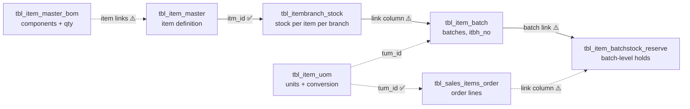
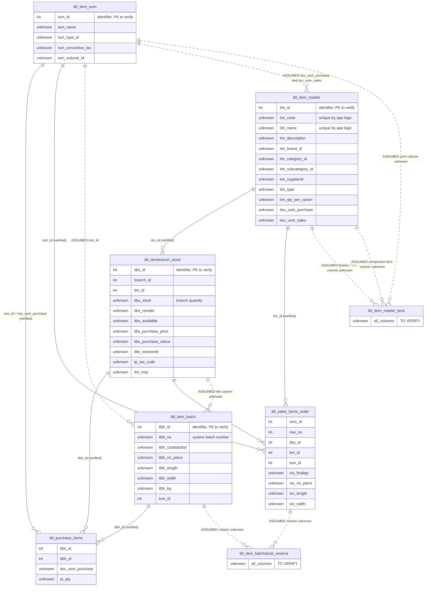
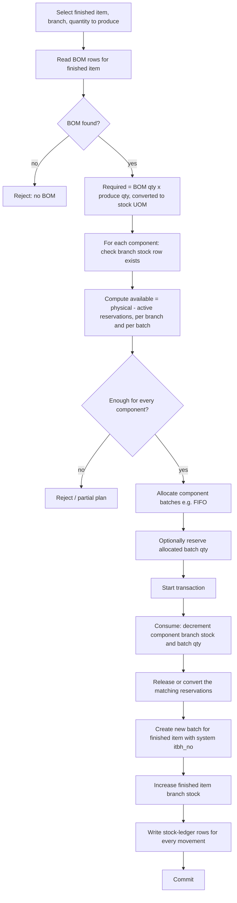
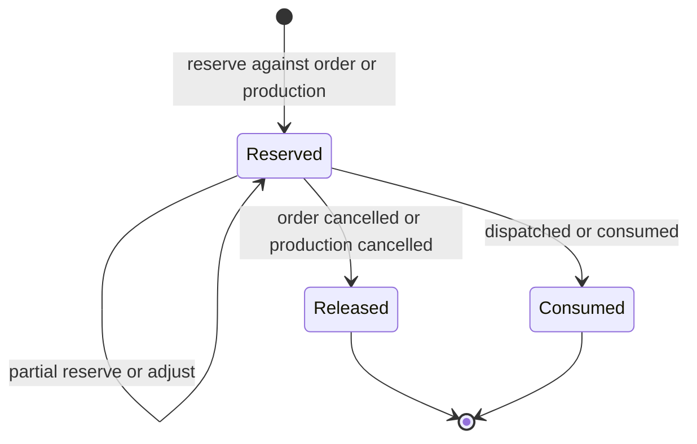
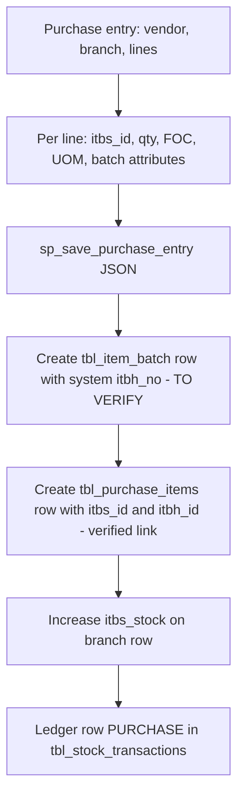
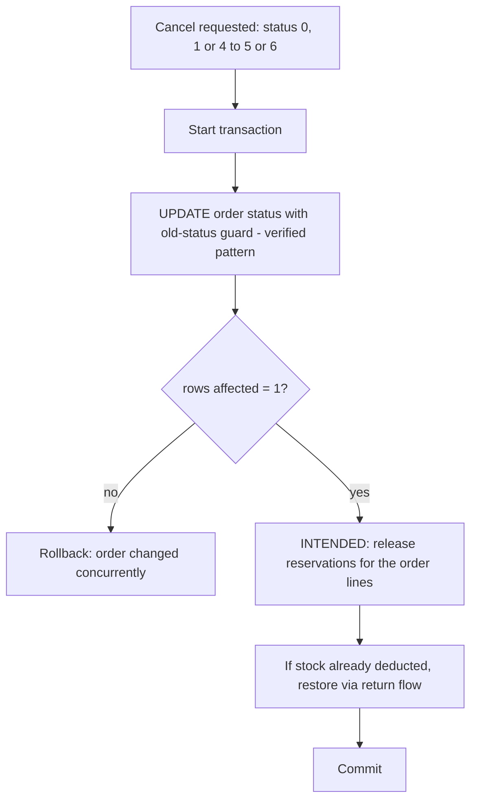

# Inventory Database Relationships

Reference for the inventory-related tables of the InvoiceMe MySQL/MariaDB database (`MySql.Data`, ASP.NET Web Forms, .NET Framework 4.8).

> **Read this first — evidence level of this document**
>
> - The repository contains **no `CREATE TABLE` scripts, schema dump, or migration history**. The only SQL file is [`sales-order-procedure.inspected.sql`](sales-order-procedure.inspected.sql) (`sp_save_sales_order_json`).
> - Per [`README.md`](README.md), the inspected database has **74 tables and no declared foreign keys**. Every relationship below is an *application convention* (matching ID columns), not a database-enforced constraint. Primary keys and column types were **not** inspected.
> - Details here come from reading application code (`web\**\*.cs`), DTO classes (`web\App_Code\*.cs`) and the procedure above. The live database was **not** queried while writing this file.
> - `tbl_item_master_bom` and `tbl_item_batchstock_reserve` are **not referenced anywhere in the application code**. Nothing about their columns is verified.
> - The stored procedures `sp_save_purchase_entry`, `sp_save_purchase_json`, `sp_save_production_entry` exist in the live database ([`README.md`](README.md)) but their definitions are **not in the repository**. They probably own the batch, production and purchase-stock rules, so those rules are `TO VERIFY`. The verified definition of `sp_save_production_entry` and the production tables is in [`production_workflow_reference.md`](production_workflow_reference.md); the production statements in this file predate it.

## Legend

| Marker | Meaning |
|---|---|
| ✅ **VERIFIED** | Seen in repository code or SQL. The source file is cited. |
| 🧭 **INTENDED** | Business design as described by the product owner or good practice. It is *not* confirmed to be implemented. |
| ⚠️ **TO VERIFY** | Unknown or assumed. Confirm against the live schema or procedures before relying on it. |

Rule for future contributors and AI assistants: **never write executable SQL against an item marked `TO VERIFY`.** Use the templates in [section 11](#11-sql-join-reference) and the verification queries in [section 13](#13-open-questions-and-schema-verification).

## Table of contents

1. [Overview](#1-overview)
2. [Table Responsibilities](#2-table-responsibilities)
3. [Table Relationships](#3-table-relationships)
4. [Entity Relationship Diagram](#4-entity-relationship-diagram)
5. [Stock Management Logic](#5-stock-management-logic)
6. [Batch Management](#6-batch-management)
7. [Bill of Materials and Production](#7-bill-of-materials-and-production)
8. [Unit of Measurement (UOM)](#8-unit-of-measurement-uom)
9. [Stock Reservation Workflow](#9-stock-reservation-workflow)
10. [End-to-End Workflows](#10-end-to-end-workflows)
11. [SQL Join Reference](#11-sql-join-reference)
12. [Data Integrity and Validation](#12-data-integrity-and-validation)
13. [Open Questions and Schema Verification](#13-open-questions-and-schema-verification)

---

## 1. Overview

The inventory model tracks **what an item is**, **how much of it each branch holds**, **which batch the stock belongs to**, **what it is made of**, **in which unit it is measured**, and **which batch stock is held back for orders or production**.

| Layer | Table | Question it answers |
|---|---|---|
| Catalog | `tbl_item_master` | What is this item? |
| Branch stock | `tbl_itembranch_stock` | How much of it does each branch hold? |
| Batch stock | `tbl_item_batch` | Which batches make up that stock? |
| Composition | `tbl_item_master_bom` | What raw materials and quantities build this item? |
| Measurement | `tbl_item_uom` | In what units, and with what conversion, is it measured? |
| Commitments | `tbl_item_batchstock_reserve` | Which batch stock is held for a sales order or production? |

How they fit together (🧭 INTENDED unless noted):



Currently verified application behaviour, in short:

- Item master rows are created and edited in `web\web_inventory\itemmaster.aspx.cs`.
- A branch stock row (`tbl_itembranch_stock`) is created per branch and item in `web\web_inventory\warehousemanagement.aspx.cs`. The application keeps the pair `(branch_id, itm_id)` unique.
- The application changes the branch quantity column `itbs_stock` directly for purchases, sales, returns and transfers. It writes a ledger row in `tbl_stock_transactions` for most of these.
- Purchase lines link to both a branch stock row (`itbs_id`) and a batch row (`itbh_id`).
- **Sales-order saving (`sp_save_sales_order_json`) does not touch stock, batches or reservations.** The "Reserved Items" tab on the order view is a static placeholder (`web\web_sales\view_sales_order.aspx`, line 256: "No reserved items available."). The reservation workflow is therefore **not wired into the application code**.

---

## 2. Table Responsibilities

### 2.1 `tbl_item_master` — item definition

| | |
|---|---|
| Purpose | One row per catalog item, independent of branch or batch. |
| Expected data | Code, name, description, brand/category/sub-category/supplier, item type, carton quantity, default purchase/sales UOM. |
| Business responsibilities | Single source of truth for what an item *is*. Branch stock rows copy some of these attributes, so a change must be propagated. |

✅ **Verified columns** (`itemmaster.aspx.cs` lines 205–250, `warehousemanagement.aspx.cs`, `new_sales_order.aspx.cs`, `editPurchase.aspx.cs`):

`itm_id`, `itm_code`, `itm_name`, `itm_description`, `itm_brand_id`, `itm_category_id`, `itm_subcategory_id`, `itm_supplierid`, `itm_type`, `itm_qty_per_carton`, `itsv_uom_purchase`, `itsv_uom_sales`.

✅ **Verified behaviour**

- `itm_id` is inserted as `null` (auto-increment) and is the item identifier used by joins.
- The application rejects an insert or update if another item has the same `itm_code` **or** the same `itm_name`. This is application-level only.
- `itm_type = 1` triggers an extra row in `tbl_coupon_master` (coupon item). Other `itm_type` values are ⚠️ TO VERIFY.
- On update, the application copies `itm_code`, `itm_name`, `itm_brand_id` and `itm_category_id` into `tbl_itembranch_stock` (denormalized snapshot).
- `sp_save_sales_order_json` validates that `tbl_item_master.itm_id` exists and reads `itm_name`, `itm_type`.

### 2.2 `tbl_itembranch_stock` — stock per item per branch

| | |
|---|---|
| Purpose | One row per `(branch, item)` holding the branch's quantity and branch-specific commercial settings. |
| Expected data | Branch, item, quantity, reorder level, availability flag, MRP, tax code, purchase price, plus copied item attributes. |
| Business responsibilities | Branch-level stock balance. `itbs_id` is the row ID that sales, purchase and transaction records use to refer to "this item at this branch". |

✅ **Verified columns** (`warehousemanagement.aspx.cs` INSERT at line ~146):

`itbs_id`, `branch_id`, `itm_id`, `itbs_stock`, `itbs_reorder`, `itbs_available`, `itm_code`, `itm_name`, `itm_brand_id`, `itm_category_id`, `itm_subcategory_id`, `itm_mrp`, `itm_commision`, `itm_target`, `tp_tax_code`, `itbs_duration`, `itm_last_update_date`, `itm_rating`, `itbs_sessionId`, `itbs_purchase_price`, `itbs_purchase_status`.

✅ **Verified behaviour**

- Uniqueness of `(branch_id, itm_id)` is checked by the application before insert and update, not by a visible constraint.
- `itbs_sessionId` is used as an idempotency token: a repeated save with the same session ID is rejected ("Item saved already").
- A branch row can be created only for an `itm_id` that exists in `tbl_item_master`.
- `itbs_available = 1` and `itbs_stock > 0` (optional) filter items in the sales-order item search. The placeholder code `'1234567891234'` ("Old Bill Item") is excluded.
- Creating a branch in `web\web_inventory\warehouse.aspx.cs` inserts a placeholder "Old Bill Item" stock row for the new branch, using a positional (column-less) `INSERT`.

### 2.3 `tbl_item_batch` — batches

| | |
|---|---|
| Purpose | Groups stock into batches. `itbh_no` is the system-maintained batch number. |
| Expected data | Batch identity and number, customer/vendor batch label, physical dimensions, cost, UOM, status, creation audit. |
| Business responsibilities | Traceability, per-batch costing, and the unit that reservations and consumption act on. |

✅ **Verified columns** (selected from `tbl_item_batch` in `managepurchase.aspx.cs` line 38 and `editPurchase.aspx.cs` line 68):

| Column | Evidence |
|---|---|
| `itbh_id` | Join key from `tbl_purchase_items.itbh_id`. |
| `itbh_no` | Selected as the batch number (`ib.itbh_no`). |
| `itbh_custbatchid` | Selected as the customer/vendor-supplied batch ID. |
| `itbh_no_piece`, `itbh_length`, `itbh_width`, `itbh_kg` | Selected in `editPurchase.aspx.cs`. |
| `tum_id` | Selected as `ib.tum_id` in `editPurchase.aspx.cs`. |

⚠️ **Probable columns (DTO field names only, not proven table columns)**: `itbh_kgmeter`, `itbh_sqmt`, `itbh_status`, `itbh_cost`, `itbh_costwithinvoice`, `itbh_costwithoutinvoice`, `itbh_costotal`, `itbh_createddate`, `itbh_createduser`. These appear in `PurchaseItem` in `web\App_Code\PurchaseModels.cs`, which is serialized to JSON and sent to `sp_save_purchase_entry`.

⚠️ **Not verified at all**: any column on `tbl_item_batch` that references the item (`itm_id`), the branch (`branch_id`) or the branch stock row (`itbs_id`), and any column holding remaining/available quantity.

### 2.4 `tbl_item_master_bom` — bill of materials

| | |
|---|---|
| Purpose | Defines the raw-material components and quantities needed to produce an item. |
| Expected data | Finished item, component item, required quantity, probably UOM. |
| Business responsibilities | Drives production requirement calculation and component validation. |

⚠️ **TO VERIFY — all of it.** No column, key, or query for this table exists in the repository. A table named `tbl_item_master_bom_old` also exists ([`README.md`](README.md)) and may be a superseded version. Its role is unknown. Related tables that may be part of production and are **not** among the six documented here: `tbl_item_pro_master`, `tbl_item_pro_items`, `tbl_item_batch_master`, `tbl_item_batch_master_items`, `tbl_itm_conversion_master`, `tbl_itm_converted_items`. `ActionType.ITEM_CONVERSION = 12` also exists in `web\App_Code\Constants.cs`, and `Manage_Conversions.aspx.cs` joins `tbl_itm_converted_items.itbs_id` to `tbl_itembranch_stock.itbs_id`. That conversion feature may overlap with production and should be inspected before designing production logic.

### 2.5 `tbl_item_uom` — units of measurement

| | |
|---|---|
| Purpose | Master list of units and their conversion relationships. |
| Business responsibilities | Defines the unit in which quantities on items, batches, purchase lines and order lines are expressed. |

✅ **Verified columns** (`new_sales_order.aspx.cs` line 102, `purchaseentry.aspx.cs` line 878, `editPurchase.aspx.cs` line 1233):

| Column | Notes |
|---|---|
| `tum_id` | Unit identifier. Joined by `tbl_sales_items_order.tum_id` and `tbl_purchase_items.itsv_uom_purchase`. |
| `tum_name` | Display name (`view_sales_order.aspx.cs` line 118). |
| `tum_type_id` | Unit type, filters the list by type. |
| `tum_convertion_fac` | Conversion factor (spelled `convertion` in the schema). The client engine `web\js\uom-conversion.js` (new, untracked file) treats it as a multiplier to a common base of its UOM type: `qty × fromFac ÷ toFac`. Whether the server and stored procedures use the same rule is ⚠️ TO VERIFY. |
| `tum_subunit_Id` | Sub-unit reference. Nullable, read as `IFNULL(...,0)`. Its meaning is ⚠️ TO VERIFY. |

`tbl_item_uom_type` (columns `tumt_id`, `tumt_name`, `tum_id`) also exists and is read by the same screens. It is not one of the six tables. `uom-conversion.js` documents its `tum_id` as the **default UOM of that category** (`tumt_name` values such as `Length` and `Area` are looked up by name). Treat this as client-side evidence, not a confirmed schema fact.

### 2.6 `tbl_item_batchstock_reserve` — batch-level reservations

| | |
|---|---|
| Purpose | Holds batch-level stock for sales orders and production. Connects to `tbl_item_batch` and `tbl_sales_items_order`. |
| Business responsibilities | Prevents the same batch quantity from being promised twice. |

⚠️ **TO VERIFY — all of it.** No column names, status values, or queries are present in the repository. The only verified fact is that the table exists in the inspected database ([`README.md`](README.md)). The order view has an unpopulated "Reserved Items" tab (`view_sales_order.aspx`, line 201 and 256).

---

## 3. Table Relationships

No foreign keys are declared. "Join condition" below means the matching-ID convention used by the code.

### 3.1 Confirmed relationships (✅ seen in code)

| # | Child (many) | Parent (one) | Join condition | Evidence |
|---|---|---|---|---|
| R1 | `tbl_itembranch_stock` | `tbl_item_master` | `tbl_itembranch_stock.itm_id = tbl_item_master.itm_id` | `warehousemanagement.aspx.cs` (item lookup then insert), `itemmaster.aspx.cs` update propagation |
| R2 | `tbl_purchase_items` | `tbl_itembranch_stock` | `tbl_purchase_items.itbs_id = tbl_itembranch_stock.itbs_id` | `managepurchase.aspx.cs` line 39 |
| R3 | `tbl_purchase_items` | `tbl_item_batch` | `tbl_purchase_items.itbh_id = tbl_item_batch.itbh_id` | `managepurchase.aspx.cs` line 39, `editPurchase.aspx.cs` line 69 |
| R4 | `tbl_purchase_items` | `tbl_item_uom` | `tbl_purchase_items.itsv_uom_purchase = tbl_item_uom.tum_id` | `managepurchase.aspx.cs` line 39 |
| R5 | `tbl_sales_items_order` | `tbl_itembranch_stock` | `tbl_sales_items_order.itbs_id = tbl_itembranch_stock.itbs_id` | `view_sales_order.aspx.cs` line 117 |
| R6 | `tbl_sales_items_order` | `tbl_item_uom` | `tbl_sales_items_order.tum_id = tbl_item_uom.tum_id` | `view_sales_order.aspx.cs` line 118 |
| R7 | `tbl_sales_items_order` | `tbl_item_master` | `tbl_sales_items_order.itm_id = tbl_item_master.itm_id` | `sales-order-procedure.inspected.sql` (validation and insert) |
| R8 | `tbl_sales_items_order` | `tbl_sales_master_order` | `tbl_sales_items_order.smo_id = tbl_sales_master_order.smo_id` | `view_sales_order.aspx.cs` line 119, procedure |
| R9 | `tbl_stock_transactions` | `tbl_itembranch_stock` | `tbl_stock_transactions.itbs_id = tbl_itembranch_stock.itbs_id` | `stockTransfer.aspx.cs` lines 167–190 |
| R10 | `tbl_itembranch_stock` | `tbl_branch` | `tbl_itembranch_stock.branch_id = tbl_branch.branch_id` | `warehousemanagement.aspx.cs` line 390 |

Indirect but confirmed: **batch ↔ branch stock** is reachable only through purchase lines (R2 + R3). This is not necessarily how the table stores the relationship itself.

### 3.2 Intended but unverified relationships (⚠️ TO VERIFY)

| # | Child | Parent | Expected join | What is missing |
|---|---|---|---|---|
| U1 | `tbl_item_batch` | `tbl_itembranch_stock` (or item + branch) | `tbl_item_batch.??? = tbl_itembranch_stock.itbs_id` | Which of `itbs_id`, `itm_id`, `branch_id` exist on the batch table. `tbl_item_batchbranch` may hold branch-level batch rows. |
| U2 | `tbl_item_batchstock_reserve` | `tbl_item_batch` | `tbl_item_batchstock_reserve.??? = tbl_item_batch.itbh_id` | Column name (likely `itbh_id`, **assumption**). |
| U3 | `tbl_item_batchstock_reserve` | `tbl_sales_items_order` | `tbl_item_batchstock_reserve.??? = tbl_sales_items_order.???` | Order-line identifier. `sp_save_sales_order_json` does not list a line ID column in its `INSERT`, so the order-line primary key name is unknown. A `(smo_id, row_no)` pair is another candidate. |
| U4 | `tbl_item_master_bom` | `tbl_item_master` (finished item) | `tbl_item_master_bom.??? = tbl_item_master.itm_id` | Parent-item column name. |
| U5 | `tbl_item_master_bom` | `tbl_item_master` (component) | `tbl_item_master_bom.??? = tbl_item_master.itm_id` | Component-item column name. It may reference `itm_id` or `itbs_id`. |
| U6 | `tbl_item_batch` | `tbl_item_uom` | `tbl_item_batch.tum_id = tbl_item_uom.tum_id` | The column exists (`ib.tum_id`); the join is *assumed* from the name. |
| U7 | `tbl_item_master` | `tbl_item_uom` | `tbl_item_master.itsv_uom_purchase / itsv_uom_sales = tbl_item_uom.tum_id` | Columns exist; the join is *assumed* from the names. |
| U8 | `tbl_item_master_bom` | `tbl_item_uom` | `tbl_item_master_bom.??? = tbl_item_uom.tum_id` | Whether the BOM stores a UOM at all. |
| U9 | `tbl_item_batchstock_reserve` | production document | unknown | Whether production reservations exist and which production table they reference (`tbl_item_pro_master`?). |

### 3.3 Keys

| Table | Primary key | Evidence |
|---|---|---|
| `tbl_item_master` | `itm_id` (**probable**) | Inserted as `null` (auto-increment). Declared PK ⚠️ TO VERIFY. |
| `tbl_itembranch_stock` | `itbs_id` (**probable**) | Inserted as `null`, `SELECT LAST_INSERT_ID()` read back. Declared PK ⚠️ TO VERIFY. |
| `tbl_item_batch` | `itbh_id` (**probable**) | Joined by `tbl_purchase_items.itbh_id`. ⚠️ TO VERIFY. |
| `tbl_item_uom` | `tum_id` (**probable**) | Used as the join target. ⚠️ TO VERIFY. |
| `tbl_item_master_bom` | unknown | ⚠️ TO VERIFY |
| `tbl_item_batchstock_reserve` | unknown | ⚠️ TO VERIFY |

Unique constraints (`(branch_id, itm_id)`, `itm_code`, `itm_name`, `itbh_no`) are enforced, at best, by application code. The database-level state is ⚠️ TO VERIFY.

---

## 4. Entity Relationship Diagram

Solid lines (`--`) are ✅ verified in code. Dotted lines (`..`) are ⚠️ **assumed** and must be confirmed. Only column names verified in code are listed, and column types are shown as `unknown` unless the code proves them. Primary-key status is not asserted. The tables `tbl_purchase_items` and `tbl_sales_items_order` are not among the six, but they carry the verified links.



---

## 5. Stock Management Logic

### 5.1 Item-level vs branch-level stock

- 🧭 There is **no stock on `tbl_item_master`** (no quantity column is known). Item-level stock is the **sum of branch stock** across all branches: `SUM(tbl_itembranch_stock.itbs_stock)` grouped by `itm_id`.
- ✅ Branch stock is one row per `(branch_id, itm_id)`, identified by `itbs_id`. Sales, purchase and transaction records reference `itbs_id`, not `itm_id`.
- ✅ A transfer or a new branch needs the destination `(branch_id, itm_id)` row to exist. `stockTransfer.aspx.cs` updates the destination row by `itm_id` + `branch_id` and has no visible `INSERT` or rows-affected check (see [section 12](#12-data-integrity-and-validation)).

### 5.2 Branch stock vs batch stock

- ✅ Branch stock quantity lives in `tbl_itembranch_stock.itbs_stock`.
- ⚠️ The batch quantity column(s) and the batch↔branch link are unknown (see U1). `tbl_item_batchbranch` may be the batch-per-branch table.
- 🧭 Intended invariant, if batch quantities exist: for each branch stock row, `SUM(batch remaining qty) = itbs_stock` (after converting to the stock-keeping UOM). Whether the application maintains this is **not verified**. The legacy stock-transfer, sales and return code paths update only `itbs_stock` and never touch batches. Expect drift on any item that is both batch-tracked and moved through those paths.

### 5.3 Physical, reserved and available stock

| Quantity | Definition (🧭 INTENDED) | Source | Verified? |
|---|---|---|---|
| **Physical** | Units actually present in the branch. | `itbs_stock` plus undelivered sales (see below) in current code. | ⚠️ |
| **Reserved** | Units held for sales orders or production. | `SUM(reserved qty)` from `tbl_item_batchstock_reserve` for active reservations. | ⚠️ (no schema) |
| **Available** | `Physical − Reserved` | Computed, never stored twice. | 🧭 |

✅ **What the existing code really does (legacy "pending sales" model).** `tbl_itembranch_stock.itbs_stock` is **already reduced by sales invoices that have not been delivered**:

- `warehousemanagement.aspx.cs` (update path, lines ~212–222): stored `itbs_stock` = *entered stock* − `SUM(si_qty + si_foc)` of `tbl_sales_items` joined to `tbl_sales_master` where `sm_delivery_status IN (0,3,6)`.
- The stock list (lines ~389–396) shows `itbs_stock + SUM(si_qty + si_foc)` over the same statuses, i.e. adds those undelivered sales back to display the *physical* figure.
- `new_sales_order.aspx.cs` filters on `itbs_stock > 0` unless zero-stock ordering is allowed.

Therefore, in current code, `itbs_stock` behaves like an **"available after committed invoices" balance**, not the physical balance. The meaning of the `sm_delivery_status` values for invoices (`0, 3, 6`) is not documented in the code and is ⚠️ TO VERIFY. For sales **orders** the page `view_sales_order.aspx.cs` uses (see `web/App_Code/SalesOrderStatus.cs`) 0 New, 1 Approved, 2 Fully Delivered, 3 Partially Delivered, 4 Pending (on hold), 5 Customer Cancelled, 6 Company Cancelled, 7 Processed (first successful reservation), and invoice statuses may differ.

> **Important design consequence:** if batch-level reservations are added on top of this model, decide explicitly whether `itbs_stock` is *physical* or *already net of commitments*. Mixing both subtracts the same units twice.

### 5.4 Preventing double-counting of reserved quantity

🧭 Recommended rules, to be confirmed against how the reservation table and `sp_save_production_entry` work:

1. Pick **one** meaning for `itbs_stock` and document it. Preferred: `itbs_stock` is physical. Available is always computed as `physical − active reservations`.
2. Never also reduce `itbs_stock` when creating a reservation. Reduce it only when stock physically leaves (dispatch or consumption).
3. When a reservation is converted to a dispatch, **release the reservation and deduct stock in the same transaction**. Otherwise the units are counted as both reserved and deducted.
4. Exclude released, cancelled or fulfilled reservations by a status or quantity predicate (the column and values are ⚠️ TO VERIFY).
5. Aggregate reservations per batch (`GROUP BY` batch) **before** joining to batches to avoid multiplying batch rows by reservation rows.
6. The existing "pending sales invoice" subtraction (section 5.3) is a second commitment mechanism. Make sure an order is not both reserved in the reserve table and pending as an invoice.

### 5.5 Reconciling across branches and batches

🧭 Reconciliation checks (create as read-only reports; templates in [section 11.7](#117-reconciliation-templates)):

| Check | Expectation |
|---|---|
| Ledger vs balance (per `itbs_id`) | Latest `tbl_stock_transactions.closing_stock` = `itbs_stock`; sum of `cr_qty − dr_qty` = balance (if the ledger starts from zero and is complete). |
| Branch vs batch | `SUM(batch remaining)` per branch stock row = physical branch quantity. |
| Item vs branches | Item total = sum over branches. A transfer must net to zero across the two branch rows. |
| Reservations vs batch | Per batch, `SUM(active reserved) ≤ batch remaining`. |

✅ Ledger note: `tbl_stock_transactions` columns seen: `id`, `itbs_id`, `action_type`, `action_ref_id`, `user_id`, `narration`, `dr_qty`, `cr_qty`, `closing_stock`, `date`. `action_type` values are in `ActionType` (`SALES=1`, `PURCHASE=2`, `SALES_RETURN=3`, `PURCHASE_RETURN=4`, `STOCK_TRANSFER=8`, `MANUAL_ITEM_EDIT=11`, `ITEM_CONVERSION=12`, ...). In the transfer code the source branch gets `dr_qty = qty`, the destination `cr_qty = qty`. Not every writer is guaranteed to log, and the ledger has no batch column in any verified query.

---

## 6. Batch Management

### 6.1 Purpose of `itbh_no`

- ✅ `itbh_no` is a column of `tbl_item_batch` read as the batch number alongside `itbh_custbatchid` (`managepurchase.aspx.cs` line 38).
- 🧭 `itbh_no` is the **system-maintained** batch number (per product owner). It should be generated by the database/stored procedure, never typed by users, and be unique. The generation rule (sequence, prefix, per-item or global, per-branch?) is ⚠️ TO VERIFY.
- ✅ `itbh_custbatchid` is a **separate, user/vendor-supplied** batch label. It is passed by the purchase screen (`PurchaseItem.itbh_custbatchid`). Do not confuse it with `itbh_no`.
- ✅ Join key is `itbh_id` (surrogate), not `itbh_no`.

### 6.2 Batches, items and branches

- ✅ Purchase lines reference both a branch stock row (`itbs_id`) and a batch row (`itbh_id`). Hence a batch is created in the context of a purchase of a specific branch item.
- ⚠️ The batch table's own item/branch columns are unknown (U1). Until verified, derive "which item and branch does a batch belong to" through `tbl_purchase_items` (query 11.2b).

### 6.3 Creation and tracking

- ✅ Batches are created on purchase. The screen sends one batch description per purchase line (`itbh_*` fields, see [section 2.3](#23-tbl_item_batch--batches)) to `sp_save_purchase_entry` as JSON. That procedure writes `tbl_item_batch` (⚠️ TO VERIFY, definition not in repo).
- ⚠️ Whether batches are also created by production (`sp_save_production_entry`), stock adjustment or returns is unknown.
- ✅ Purchase edit loads batch data through `tbl_purchase_items.itbh_id` (`editPurchase.aspx.cs`).

### 6.4 Consumption and updates

⚠️ **Unverified**: no code in the repository decrements a batch quantity. Intended behaviour (🧭):

- Dispatch (sale) and production consumption reduce the remaining quantity of specific batches, and every reduction is tied to the source document.
- A reservation does *not* reduce batch quantity. It reduces **available** batch quantity only.
- Returns restore quantity to the originating batch, not to a new batch.
- Prefer a ledger of batch movements (document type, document ID, batch, ± quantity) over overwriting a quantity, so a batch balance can always be rebuilt. No such batch ledger is verified.

### 6.5 Traceability requirements

🧭 For each batch, one should be able to answer:

| Question | Path |
|---|---|
| Where did it come from? | `tbl_item_batch` → purchase line (`itbh_id`) → purchase header (`pm_id`) → vendor. Verified link: R3. |
| What item and branch? | via `itbs_id` of the purchase line (verified) or batch columns (unknown). |
| What was made from it? | production consumption records (⚠️ unknown tables). |
| What is it reserved for? | `tbl_item_batchstock_reserve` → `tbl_sales_items_order` (⚠️ columns unknown). |
| What was sold or dispatched from it? | ⚠️ **No batch reference exists on `tbl_sales_items_order`** (not in `sp_save_sales_order_json`). Whether invoice lines (`tbl_sales_items`) carry `itbh_id` is unknown. |

---

## 7. Bill of Materials and Production

> **Everything in this section is 🧭 intended business logic.** No code in the repository reads `tbl_item_master_bom` or implements production. `sp_save_production_entry` exists in the database but its definition is not in the repository.

### 7.1 BOM structure

⚠️ TO VERIFY. Expected shape (names are placeholders, **not** real columns):

| Concept | Purpose |
|---|---|
| Finished item reference | The item being produced. |
| Component item reference | A raw-material item (item or branch-stock level unknown). |
| Required quantity | Quantity of the component per one unit (or per BOM batch) of the finished item. |
| Component UOM | Unit of that quantity, if stored. |
| Optional: yield/wastage, status, version | Unknown. |

Open points: whether the BOM is single-level or multi-level; whether `tbl_item_master_bom_old` is historical; whether quantities are per one unit of finished item.

### 7.2 Intended production workflow



| Step | Intended action | Verified implementation |
|---|---|---|
| 1. Read BOM | Select BOM rows for the finished item. | ⚠️ None in repo |
| 2. Required quantities | `required = bom_qty × qty_to_produce`, converted to each component's stock UOM, rounded per UOM rules. | ⚠️ None |
| 3. Validate availability | Per branch (row in `tbl_itembranch_stock`) and per batch (available = remaining − reserved). | ⚠️ None |
| 4. Consume | Decrement component branch stock and consumed batch quantities atomically. | ⚠️ `sp_save_production_entry` may do this. Definition unavailable. |
| 5. Create finished batch | Insert a new `tbl_item_batch` row (new `itbh_no`) and increase finished-item branch stock. | ⚠️ unknown |
| 6. Reservations | Reserve components before consumption if needed; release/convert on consumption; release remainder on cancellation. | ⚠️ unknown (no schema evidence) |
| 7. Ledger | `tbl_stock_transactions` rows. `ActionType` has no explicit "production" value (only `ITEM_CONVERSION = 12`). | ⚠️ unknown |

**Before implementing production features, fetch `SHOW CREATE PROCEDURE sp_save_production_entry` and the BOM table definition (section 13), and read `tbl_itm_conversion_master` / `tbl_itm_converted_items` (the existing conversion workflow).**

---

## 8. Unit of Measurement (UOM)

### 8.1 What is verified

| Fact | Evidence |
|---|---|
| `tbl_item_uom` columns: `tum_id`, `tum_name`, `tum_type_id`, `tum_convertion_fac`, `tum_subunit_Id`. | `new_sales_order.aspx.cs` line 102. |
| UOMs are grouped by type (`tum_type_id`, `tbl_item_uom_type`). Purchase screens filter units by type. | `purchaseentry.aspx.cs` lines 878–881. |
| Items have a default **purchase** UOM (`itsv_uom_purchase`) and **sales** UOM (`itsv_uom_sales`). | `new_sales_order.aspx.cs` line 56, `editPurchase.aspx.cs` line 1180. |
| Sales-order lines carry `tum_id` (defaults to `0` if missing, and the screen requires `tum_id > 0`). They also carry `sio_no_piece`, `sio_length`, `sio_width`, `sio_finalqty`. | procedure insert; `new_sales_order.aspx.cs` line 137. |
| Purchase lines carry `itsv_uom_purchase`; batches carry `tum_id`, `itbh_no_piece`, `itbh_length`, `itbh_width`, `itbh_kg`. | `managepurchase.aspx.cs`, `editPurchase.aspx.cs`. |
| `sio_finalqty` must be `> 0` for an order line. | procedure error 30010. |

### 8.1a Client-side conversion rules (✅ verified in `web\js\uom-conversion.js`, untracked/new)

The `UomConversion` script is the only conversion logic found in the repository. It runs in the browser and is fed from `tbl_item_uom` and `tbl_item_uom_type` (`loadUomData`, `loadUomTypes` web methods).

| Rule | Behaviour |
|---|---|
| Valid UOM | The UOM exists, its type (`tum_type_id`) exists in `tbl_item_uom_type`, and `tum_convertion_fac > 0`. |
| Conversion | Only within the same `tum_type_id`: `result = qty × fromFac ÷ toFac`. Cross-category conversion is an error. |
| Default (base) UOM | `tbl_item_uom_type.tum_id` is the category's default UOM. If unset or `<= 0`, the quantity stays in its own unit with a warning. |
| Final quantity | Target unit is the item's `itsv_uom_purchase` (`calculateForTarget`). *Length* category: `length × quantity` (quantity treated as 1 if blank). *Area* category: `length × width × quantity`, with length and width in the UOM's linear unit. Other categories: quantity as entered. |
| Rounding | Client side only: round to **4 decimals** (`Math.round((v + EPSILON) × 10000) / 10000`). |

The server (`sp_save_sales_order_json`, `sp_save_purchase_entry`) stores whatever quantity the client sends. It performs no conversion and no recomputation that is visible in the repository. Treat server-side re-validation as ⚠️ TO VERIFY.

### 8.2 What is NOT verified

- Whether `tum_convertion_fac` and `tbl_item_uom_type.tum_id` mean the same in the database and stored procedures as in the client script, and the meaning of `tum_subunit_Id`.
- Whether a "base unit" per UOM type exists in the database in a form other than `tbl_item_uom_type.tum_id`.
- Whether `tbl_itembranch_stock.itbs_stock` is expressed in the item's purchase UOM, sales UOM, or a base unit. The code adds purchase `pi_qty + pi_foc` directly, with `Convert.ToInt32` (**truncates fractions**), to `itbs_stock` with no visible conversion (legacy path in `purchaseentry.aspx.cs` line 508–515. The currently active path is `sp_save_purchase_entry`, whose behaviour is unknown).
- How `sio_finalqty` relates to `sio_no_piece × sio_length × sio_width` on the server. The client script computes the final quantity (8.1a), but the order procedure only stores what it receives.
- Precision and rounding rules on the server. The order procedure declares only the tax and cess rate variables as `DECIMAL(5, 2)`. Quantity column scales are unknown.

### 8.3 Intended interaction rules (🧭)

| Area | Rule |
|---|---|
| Items | Each item has one **stock-keeping (base) UOM**. Default purchase/sales UOMs may differ and must be convertible to it. |
| BOM | Component quantity is stored in a stated UOM. Convert to the component's stock UOM before comparing with stock. |
| Batches | Quantity stored in a known UOM (`tbl_item_batch.tum_id`). Use the physical dimensions (pieces/length/width/kg) as descriptive attributes unless the formula is verified. |
| Reservations | Reserve in the batch's own UOM, or convert at reservation time. Never compare quantities in different UOMs. |
| Sales | Order-line quantity is in `tbl_sales_items_order.tum_id`. Convert to stock UOM when checking availability and reserving. |
| Rounding | Convert once, at one defined point, with a documented rounding mode and a scale that is at least that of the stock column. Avoid integer casts (`Convert.ToInt32`) on fractional quantities. |

Conversion rule as implemented by the client script (apply server-side only after confirming the database semantics):

```text
qty_in_target = qty_in_source * source.tum_convertion_fac / target.tum_convertion_fac   -- same tum_type_id only
```

---

## 9. Stock Reservation Workflow

> ⚠️ The schema of `tbl_item_batchstock_reserve` is unverified. The workflow below describes *what must happen*, using generic concepts instead of column or status names. Replace placeholders only after confirming the schema.

### 9.1 Concepts

| Concept | Placeholder | Notes |
|---|---|---|
| Reserved batch | `<batch ref>` → `tbl_item_batch` | Column ⚠️ |
| Order line | `<order line ref>` → `tbl_sales_items_order` | Column ⚠️ (`sio` primary key unknown) |
| Production document | `<production ref>` | Table/column ⚠️ |
| Reserved quantity | `<reserved qty>` | Column and UOM ⚠️ |
| Reservation state | `<state>` | Existence and values ⚠️ |

### 9.2 Reservation lifecycle



This is a *conceptual* lifecycle. The real table may use status values, quantities, deletes, or a different model.

### 9.3 Workflow rules (🧭)

| Scenario | Intended behaviour |
|---|---|
| **Reserve against a sales order** | For each order line: convert the line quantity to the batch UOM; choose batch(es) of the line's item in the order's branch; insert reservation row(s) up to the available quantity; link to the order line and batch. Currently `sp_save_sales_order_json` does **not** do this (verified). |
| **Reserve raw materials for production** | Same, but linked to the production document and the BOM component quantity. |
| **Partial reservation** | Reserve what is available, record the shortfall on the order line (e.g. status), and allow more reservations later. One order line may have several reservation rows (one per batch). |
| **Release on cancellation** | When an order moves to Customer/Company Cancelled (status 5/6 in `view_sales_order.aspx.cs`), release all of its reservations in the same transaction as the status change. The current status update only changes `tbl_sales_master_order` and does not touch reservations (verified). |
| **Deduction at dispatch / consumption** | In one transaction: reduce batch remaining quantity, reduce branch stock (`itbs_stock`), write ledger rows, and mark reservation fulfilled/remove it. |
| **Prevent over-reservation** | Inside a transaction, lock the batch row (`SELECT … FOR UPDATE`), compute `remaining − SUM(active reservations)`, and only insert if `new qty ≤ that value`. |
| **Concurrent allocation** | Lock rows in a consistent order (e.g. ascending `itbh_id`), keep transactions short, and retry on deadlock. Optionally add a unique key on `(order line, batch)` to avoid duplicate rows. |

### 9.4 Interaction with the legacy order flow (verified)

- Status transitions are guarded with an optimistic predicate `smo_delivery_status = @old` and a branch scope (`view_sales_order.aspx.cs` lines 319–320). Reuse this pattern when adding reservation updates, but run them in the **same transaction** as the status change.
- Approve: 0 or 4 -> 1. Put on hold: 0, 1 or 7 -> 4 (reservations kept). Cancel: 0, 1, 4 or 7 -> 5/6 (reservations released in the same transaction). Reopen: 5/6 -> 0. Reserve/produce only in 1 or 7; the first successful reservation moves 1 -> 7 in the same transaction.

---

## 10. End-to-End Workflows

Legend: ✅ = what the code does today, 🧭 = intended or recommended, ⚠️ = unknown.

### 10.1 Create a new item

1. ✅ Insert into `tbl_item_master` (`itemmaster.aspx.cs`): code, name, description, brand, category, sub-category, supplier, type, carton quantity. Uniqueness of code **or** name is checked first.
2. ✅ If `itm_type = 1`, also insert a `tbl_coupon_master` row.
3. 🧭 Set default purchase and sales UOM (`itsv_uom_purchase`, `itsv_uom_sales`). ⚠️ The code path that writes them is not visible in the insert above.
4. ✅ For each branch that will stock it, insert a `tbl_itembranch_stock` row (`warehousemanagement.aspx.cs`): the pair `(branch_id, itm_id)` must be unique, `itbs_sessionId` prevents double submit.
5. ✅ If an opening stock quantity is entered, a `tbl_stock_transactions` row with `ActionType.MANUAL_ITEM_EDIT (11)` is written.
6. ⚠️ If the item is made from a BOM, add its `tbl_item_master_bom` rows (not implemented in the repo).

### 10.2 Receive stock into a branch and batch



- ✅ The screen calls `sp_save_purchase_entry` (`purchaseentry.aspx.cs` line ~108) inside an application transaction. Inputs are JSON header, JSON lines, current datetime, and outputs are `purchase_id` and a JSON result.
- ✅ A legacy inline path in the same file performs `UPDATE tbl_itembranch_stock SET itbs_stock = itbs_stock + (qty+FOC)` and writes a `PURCHASE` ledger row. Whether it is still used is ⚠️ TO VERIFY.
- ⚠️ Where batch rows and batch quantities are created is only visible inside the stored procedure (not in the repo).

### 10.3 Transfer stock between branches

- ✅ `stockTransfer.aspx.cs` `saveTransferItems`, in one DB transaction:
  1. Insert `tbl_stock_transfer_header` (user, from branch, to branch, date, type `1`).
  2. For each item: insert `tbl_stock_transfer_items`, then `itbs_stock = itbs_stock − qty` on the source `(itm_id, branch_id)`, then `itbs_stock = itbs_stock + qty` on the destination row.
  3. Insert paired ledger rows (`STOCK_TRANSFER = 8`): source `dr_qty`, destination `cr_qty`.
- ⚠️ **Not handled in code:** batch selection or batch movement; source stock sufficiency; missing destination row; reservations on the source. The queries are built by string concatenation.
- 🧭 Recommended: validate `available ≥ qty` on the source, require destination row (or create it), move specific batches (creating or updating destination batch rows and keeping `itbh_no` traceable), and fail the whole transaction on any shortfall.

### 10.4 Manufacture an item using a BOM

See [section 7.2](#72-intended-production-workflow). ⚠️ No verified implementation. Inspect `sp_save_production_entry` first.

### 10.5 Reserve stock for a sales order

```mermaid
flowchart TD
    A[Order saved: sp_save_sales_order_json<br/>no stock effect - verified] --> B[Order approved: status 0 or 4 to 1 (Approved); first reservation moves 1 to 7 (Processed)]
    B --> C[INTENDED: for each order line convert qty to batch UOM]
    C --> D[Lock candidate batch rows]
    D --> E{available >= required?}
    E -- yes --> F[Insert reservation rows against batches]
    E -- partial --> G[Reserve available, flag shortfall]
    E -- none --> H[Leave unreserved, report]
```

- ✅ Orders are saved with `itbs_id`, `itm_id`, `tum_id`, `sio_finalqty` and without batch references. Item existence is validated, stock is not.
- ⚠️ The decision of **when** to reserve (on save, approve, or process) is a business rule that is not documented.

### 10.6 Dispatch an order and update stock

- ✅ Statuses 2 (Fully Delivered) and 3 (Partially Delivered) exist on orders. `view_sales_order.aspx.cs` does not provide actions for them and does not update stock.
- ✅ Legacy invoices (`tbl_sales_master` / `tbl_sales_items`, ~`app_Admin.aspx.cs`, `app_Salesman.aspx.cs`, `app_Warehouse.aspx.cs`) change `itbs_stock` directly and use `sm_delivery_status`.
- ✅ Invoicing against an order (`sales_order_invoice.aspx`, `web\App_Code\SalesOrderInvoice.cs`): the invoice is linked with `tbl_sales_master.sm_refid = smo_id`, `sm_is_inter_stock_transfer_invoice = 0` and `tbl_sales_items.sio_id`. In the same transaction the order line's reservation rows (`tbl_item_batchstock_reserve`, same item only) are reduced or deleted oldest batch first, `tbl_item_batch.itbh_currentqty` and `itbs_stock` are reduced by the invoiced quantity in the batch UOM, and `tbl_stock_transactions` gets one row per batch. Partial and repeated invoices are supported; the order status is not changed.
- 🧭 Intended: in one transaction, reduce batch remaining quantity from the reserved batches, reduce branch stock, mark reservations fulfilled, write ledger rows, update the delivery status (optimistically guarded), and keep partial deliveries partially reserved.

### 10.7 Cancel an order and release reservations



- ✅ Cancellation currently only updates the order header status (guarded by old status and branch membership).
- 🧭 Releasing reservations must happen in the same transaction as the status update.

---

## 11. SQL Join Reference

Rules for this section:

- **Executable** queries use only columns verified in code.
- **Templates** contain `<<PLACEHOLDER>>` tokens. They **must not be run** until the required information is confirmed.
- All queries are read-only. Use parameters (`@name`) from application code; never concatenate user input.

### 11.1 Item details with branch stock — ✅ executable

```sql
SELECT im.itm_id,
       im.itm_code,
       im.itm_name,
       ibs.itbs_id,
       br.branch_id,
       br.branch_name,
       ibs.itbs_stock,
       ibs.itbs_reorder,
       ibs.itbs_available
FROM tbl_item_master im
JOIN tbl_itembranch_stock ibs ON ibs.itm_id = im.itm_id
JOIN tbl_branch br            ON br.branch_id = ibs.branch_id
WHERE im.itm_id = @itm_id;
```

`itbs_stock` here follows the legacy meaning (see 5.3). Do not label it "physical".

### 11.2 Item details with batch quantities

**a) Template — direct batch table (⚠️ link and quantity columns unknown)**

Required information: batch→item/branch-stock column(s) on `tbl_item_batch`, the remaining-quantity column(s), the status column and its values.

```sql
-- TEMPLATE — DO NOT RUN until the placeholders are verified
SELECT im.itm_code, im.itm_name,
       ib.itbh_no, ib.itbh_custbatchid,
       ib.<<BATCH_REMAINING_QTY_COLUMN>> AS batch_qty
FROM tbl_item_master im
JOIN tbl_itembranch_stock ibs ON ibs.itm_id = im.itm_id
JOIN tbl_item_batch ib        ON ib.<<BATCH_TO_BRANCHSTOCK_COLUMN>> = ibs.itbs_id
WHERE ibs.branch_id = @branch_id
  AND ib.<<BATCH_ACTIVE_FILTER>>;
```

**b) ✅ executable — batches as they were received (via purchase lines)**

Shows the batch descriptors for each purchase line, linked to item and branch stock through verified joins. `pi_qty` is the *purchased* quantity, **not** the remaining batch stock.

```sql
SELECT im.itm_code, im.itm_name, ibs.branch_id,
       pi.pm_id, pi.row_no,
       ib.itbh_id, ib.itbh_no, ib.itbh_custbatchid,
       ib.itbh_no_piece, ib.itbh_length, ib.itbh_width, ib.itbh_kg,
       ib.tum_id AS batch_tum_id,
       pi.pi_qty
FROM tbl_purchase_items pi
JOIN tbl_item_batch ib        ON ib.itbh_id = pi.itbh_id
JOIN tbl_itembranch_stock ibs ON ibs.itbs_id = pi.itbs_id
JOIN tbl_item_master im       ON im.itm_id = ibs.itm_id
WHERE ibs.itm_id = @itm_id;
```

### 11.3 Batch-level reservation summaries — template only

Required information: reservation table's batch column, quantity column, state/active predicate, and the UOM column (if quantities may be in different UOMs).

```sql
-- TEMPLATE — DO NOT RUN until the placeholders are verified
SELECT ib.itbh_id,
       ib.itbh_no,
       COALESCE(r.reserved_qty, 0) AS reserved_qty
FROM tbl_item_batch ib
LEFT JOIN (
    SELECT <<RESERVE_BATCH_COLUMN>> AS itbh_id,
           SUM(<<RESERVE_QTY_COLUMN>>) AS reserved_qty
    FROM tbl_item_batchstock_reserve
    WHERE <<RESERVE_ACTIVE_PREDICATE>>
    GROUP BY <<RESERVE_BATCH_COLUMN>>
) r ON r.itbh_id = ib.itbh_id;
```

Aggregate before joining, so a batch with several reservations is not duplicated.

### 11.4 Available stock by item and branch

**a) ✅ executable — the legacy "displayed stock" figure**

Reproduces the stock-list calculation in `warehousemanagement.aspx.cs`. `physical_estimate` assumes the legacy interpretation in 5.3. Verify it before using it as a hard number.

```sql
SELECT ibs.itbs_id,
       ibs.branch_id,
       ibs.itm_id,
       ibs.itbs_stock                                  AS stored_stock,
       IFNULL(p.pending_qty, 0)                        AS undelivered_invoice_qty,
       ibs.itbs_stock + IFNULL(p.pending_qty, 0)       AS physical_estimate
FROM tbl_itembranch_stock ibs
LEFT JOIN (
    SELECT si.itbs_id, SUM(si.si_qty + si.si_foc) AS pending_qty
    FROM tbl_sales_items si
    JOIN tbl_sales_master sm ON sm.sm_id = si.sm_id
    WHERE sm.sm_delivery_status IN (0, 3, 6)
    GROUP BY si.itbs_id
) p ON p.itbs_id = ibs.itbs_id
WHERE ibs.itm_id = @itm_id;
```

**b) Template — available after batch reservations (⚠️)**

```sql
-- TEMPLATE — DO NOT RUN until the placeholders are verified
SELECT ibs.itbs_id, ibs.branch_id, ibs.itm_id,
       <<PHYSICAL_QTY_EXPRESSION>>                      AS physical_qty,
       COALESCE(res.reserved_qty, 0)                    AS reserved_qty,
       <<PHYSICAL_QTY_EXPRESSION>> - COALESCE(res.reserved_qty, 0) AS available_qty
FROM tbl_itembranch_stock ibs
LEFT JOIN (
    SELECT ib.<<BATCH_TO_BRANCHSTOCK_COLUMN>> AS itbs_id,
           SUM(r.<<RESERVE_QTY_COLUMN>>)      AS reserved_qty
    FROM tbl_item_batchstock_reserve r
    JOIN tbl_item_batch ib ON ib.itbh_id = r.<<RESERVE_BATCH_COLUMN>>
    WHERE r.<<RESERVE_ACTIVE_PREDICATE>>
    GROUP BY ib.<<BATCH_TO_BRANCHSTOCK_COLUMN>>
) res ON res.itbs_id = ibs.itbs_id;
```

Use only one of: *legacy subtraction of pending invoices* **or** *reservation subtraction*, for the same units (section 5.4).

### 11.5 BOM component lookup — template only

Required information: BOM column names (finished item, component item, quantity, UOM, status/version), and whether the component refers to `itm_id` or `itbs_id`.

```sql
-- TEMPLATE — DO NOT RUN until the placeholders are verified
SELECT fin.itm_code  AS finished_item_code,
       comp.itm_code AS component_item_code,
       comp.itm_name AS component_item_name,
       bom.<<BOM_QTY_COLUMN>> AS required_qty_per_unit,
       u.tum_name             AS bom_uom
FROM tbl_item_master_bom bom
JOIN tbl_item_master fin  ON fin.itm_id  = bom.<<BOM_FINISHED_ITEM_COLUMN>>
JOIN tbl_item_master comp ON comp.itm_id = bom.<<BOM_COMPONENT_ITEM_COLUMN>>
LEFT JOIN tbl_item_uom u  ON u.tum_id    = bom.<<BOM_UOM_COLUMN>>
WHERE fin.itm_id = @finished_itm_id;
```

### 11.6 Sales-order reservation lookup

**a) ✅ executable — the order lines to reserve for**

```sql
SELECT smo.smo_id,
       smo.smo_delivery_status,
       sio.row_no,
       sio.itbs_id,
       sio.itm_id,
       sio.itm_name,
       sio.tum_id,
       u.tum_name,
       sio.sio_finalqty
FROM tbl_sales_master_order smo
JOIN tbl_sales_items_order sio ON sio.smo_id = smo.smo_id
LEFT JOIN tbl_item_uom u       ON u.tum_id = sio.tum_id
WHERE smo.smo_id = @smo_id
ORDER BY sio.row_no;
```

**b) Template — add the reservations (⚠️)**

Required information: the reservation column that references the order line and its identifier on `tbl_sales_items_order` (`smo_id` + `row_no`, or a line primary key).

```sql
-- TEMPLATE — DO NOT RUN until the placeholders are verified
SELECT sio.smo_id, sio.row_no, sio.itm_name, sio.sio_finalqty,
       ib.itbh_no,
       r.<<RESERVE_QTY_COLUMN>> AS reserved_qty
FROM tbl_sales_items_order sio
JOIN tbl_item_batchstock_reserve r ON r.<<RESERVE_ORDERLINE_COLUMN>> = sio.<<ORDERLINE_KEY_COLUMN>>
JOIN tbl_item_batch ib             ON ib.itbh_id = r.<<RESERVE_BATCH_COLUMN>>
WHERE sio.smo_id = @smo_id;
```

### 11.7 Reconciliation templates

**✅ Ledger vs stored balance** (assumes the ledger is complete for the row, which is ⚠️ TO VERIFY):

```sql
SELECT ibs.itbs_id,
       ibs.itbs_stock,
       (SELECT st.closing_stock
          FROM tbl_stock_transactions st
         WHERE st.itbs_id = ibs.itbs_id
         ORDER BY st.date DESC, st.id DESC
         LIMIT 1) AS last_closing_stock
FROM tbl_itembranch_stock ibs
WHERE ibs.itbs_id = @itbs_id;
```

**Branch vs batch (⚠️ template):**

```sql
-- TEMPLATE — DO NOT RUN until the placeholders are verified
SELECT ibs.itbs_id, ibs.itbs_stock AS branch_qty,
       SUM(ib.<<BATCH_REMAINING_QTY_COLUMN>>) AS batch_qty
FROM tbl_itembranch_stock ibs
LEFT JOIN tbl_item_batch ib ON ib.<<BATCH_TO_BRANCHSTOCK_COLUMN>> = ibs.itbs_id
GROUP BY ibs.itbs_id, ibs.itbs_stock
HAVING branch_qty <> COALESCE(batch_qty, 0);
```

---

## 12. Data Integrity and Validation

Because the database declares no constraints, each rule is **application or procedure responsibility** unless a constraint is added after verification. Status column: ✅ = currently seen in code, ❌ = **not seen** in the inspected code, 🧭 = recommended.

| Rule | Current state | Recommended enforcement |
|---|---|---|
| **No negative stock** | ❌ Transfer decrements `itbs_stock` with no sufficiency check (`stockTransfer.aspx.cs`). Sales search hides zero-stock items only when zero-stock orders are disallowed (✅ `new_sales_order.aspx.cs`), which is a UI filter. | Guarded update: `UPDATE … SET itbs_stock = itbs_stock - @q WHERE itbs_id = @id AND itbs_stock >= @q`, then check rows affected. Consider a `CHECK (itbs_stock >= 0)` only after cleaning data, and only if the legacy "net of pending invoices" model allows it. |
| **No reservation beyond available** | ❌ No reservation code exists. | Lock and re-check available quantity in the reserving transaction (section 9.3). |
| **Batch ↔ item consistency** | ⚠️ Unknown whether batch carries `itm_id`. | A batch used for an order line or BOM component must belong to the same item (and branch) as the line. Validate with the verified joins plus the verified batch link. |
| **UOM conversion** | ❌ No conversion visible. `Convert.ToInt32` truncates fractional stock quantities in the legacy purchase path. | Convert in one place, with decimal arithmetic and a documented rounding mode. Reject quantities that cannot be converted exactly. |
| **Branch stock ↔ batch stock** | ⚠️ Unknown. Legacy writers update only `itbs_stock`. | Update both in the same transaction, or compute branch stock from batches. Run the reconciliation query regularly. |
| **Unique `(branch_id, itm_id)`** | ✅ App check only (`warehousemanagement.aspx.cs`). | Add a unique index after confirming no duplicates exist. |
| **Unique `itm_code` / `itm_name`** | ✅ App check only. | Unique index after cleanup. |
| **Existing item** | ✅ Sales-order procedure validates `itm_id` in item master. | Keep. Add same checks for BOM rows and reservations. |
| **Idempotent saves** | ✅ `itbs_sessionId` (branch stock), `smo_sales_sessionid` (orders, error 30004). | Use the same token pattern for reservation and production requests. |
| **Atomic multi-table writes** | ✅ Transfers and purchases use transactions. Procedure `sp_save_sales_order_json` wraps the order in a transaction with an `EXIT HANDLER` rollback. | All stock, batch, reservation and ledger changes for one business event go in one transaction. |
| **Concurrent updates** | ✅ Stock changes use relative arithmetic (`itbs_stock = itbs_stock + x`), which is safe against lost updates. ✅ Order status changes use `WHERE smo_delivery_status = @old`. ❌ No `SELECT … FOR UPDATE` was found. | Use row locks for read-then-write sequences (availability check followed by reserve), lock in a consistent order, and keep transactions short. |
| **Stock-ledger coverage** | ✅ Present for purchase, transfer, and manual edit. Some flows are ⚠️ unknown. | Every change to `itbs_stock` writes a `tbl_stock_transactions` row. |
| **SQL injection** | ❌ Many stock writers concatenate values into SQL (e.g. `stockTransfer.aspx.cs`, `purchaseentry.aspx.cs`). | Use parameters, as the `warehousemanagement.aspx.cs` insert already does. |
| **Helper error handling** | The MySQL helper can return `null`/`false` on errors ([`README.md`](README.md)). | Check every result. A silent failure on one of several statements can leave partial updates unless the transaction is rolled back. |

---

## 13. Open Questions and Schema Verification

### 13.1 How to verify (read-only)

Run against the target database. Do not run schema- or data-changing SQL. Do not paste credentials into tickets or documents.

```sql
-- Column definitions for the six tables
SELECT TABLE_NAME, ORDINAL_POSITION, COLUMN_NAME, COLUMN_TYPE, IS_NULLABLE, COLUMN_KEY, COLUMN_DEFAULT, EXTRA
FROM INFORMATION_SCHEMA.COLUMNS
WHERE TABLE_SCHEMA = DATABASE()
  AND TABLE_NAME IN ('tbl_item_master','tbl_itembranch_stock','tbl_item_batch',
                     'tbl_item_master_bom','tbl_item_uom','tbl_item_batchstock_reserve',
                     'tbl_sales_items_order','tbl_item_batchbranch','tbl_item_uom_type')
ORDER BY TABLE_NAME, ORDINAL_POSITION;

-- Declared keys, unique indexes and foreign keys
SELECT TABLE_NAME, INDEX_NAME, NON_UNIQUE, SEQ_IN_INDEX, COLUMN_NAME
FROM INFORMATION_SCHEMA.STATISTICS
WHERE TABLE_SCHEMA = DATABASE()
  AND TABLE_NAME IN ('tbl_item_master','tbl_itembranch_stock','tbl_item_batch',
                     'tbl_item_master_bom','tbl_item_uom','tbl_item_batchstock_reserve',
                     'tbl_sales_items_order','tbl_item_batchbranch')
ORDER BY TABLE_NAME, INDEX_NAME, SEQ_IN_INDEX;

SELECT * FROM INFORMATION_SCHEMA.TABLE_CONSTRAINTS
WHERE TABLE_SCHEMA = DATABASE() AND CONSTRAINT_TYPE IN ('FOREIGN KEY','CHECK','UNIQUE');

-- Triggers and procedure bodies that may own the business rules
SELECT TRIGGER_NAME, EVENT_OBJECT_TABLE, ACTION_TIMING, EVENT_MANIPULATION
FROM INFORMATION_SCHEMA.TRIGGERS WHERE TRIGGER_SCHEMA = DATABASE();

SHOW CREATE PROCEDURE sp_save_purchase_entry;
SHOW CREATE PROCEDURE sp_save_production_entry;
SHOW CREATE PROCEDURE sp_save_purchase_json;
```

Save the confirmed results as a schema snapshot in the repository, and then update this document. Replace each `TO VERIFY` with the confirmed fact and its source.

### 13.2 Checklist

**Keys and constraints**

- [ ] Primary keys of all six tables (and `tbl_sales_items_order`).
- [ ] Any unique indexes: `(branch_id, itm_id)`, `itm_code`, `itm_name`, `itbh_no`.
- [ ] Column types and scales of every quantity column (stock, batch, reserve, BOM, order).
- [ ] Whether any triggers exist.

**`tbl_item_batch`**

- [ ] Columns linking a batch to item, branch and/or `itbs_id` (U1).
- [ ] Which column holds the remaining / current quantity. Is there an initial quantity too?
- [ ] Whether `itbh_kgmeter`, `itbh_sqmt`, `itbh_status`, `itbh_cost*`, `itbh_createddate`, `itbh_createduser` are real columns.
- [ ] `itbh_no` generation rule: sequence, uniqueness scope, who writes it.
- [ ] Meaning of `itbh_status` values (active, exhausted, blocked?).
- [ ] Role of `tbl_item_batchbranch`, `tbl_item_batch_master` and `tbl_item_batch_master_items` relative to `tbl_item_batch`.
- [ ] Whether batch `tum_id` joins `tbl_item_uom.tum_id` (U6).

**`tbl_itembranch_stock`**

- [ ] Is `itbs_stock` physical or net of pending invoices? Confirm the 5.3 interpretation. Does it include reservations?
- [ ] Meaning of `sm_delivery_status` values `0`, `3`, `6` for invoices.
- [ ] Unit (UOM) in which `itbs_stock` is stored.
- [ ] Meaning of `itbs_available` values and `itbs_purchase_status`.
- [ ] How branch stock relates to `tbl_item_batchbranch` and `tbl_central_stock`.

**`tbl_item_master_bom`**

- [ ] All columns; finished-item and component-item columns, quantity semantics (per one unit?), UOM column.
- [ ] Single-level or multi-level; versioning or status; role of `tbl_item_master_bom_old`.
- [ ] Whether the component references `itm_id` or `itbs_id`.

**`tbl_item_uom`**

- [ ] Confirm `tum_convertion_fac` semantics (client uses `qty × from ÷ to`); meaning of `tum_subunit_Id`; confirm `tbl_item_uom_type.tum_id` is the category default/base UOM.
- [ ] Whether the server or stored procedures re-validate or recompute converted quantities.
- [ ] Whether item master `itsv_uom_purchase` / `itsv_uom_sales` reference `tum_id` (U7).
- [ ] Rounding rules and decimal scale for conversions; how `sio_finalqty` relates to pieces × length × width.

**`tbl_item_batchstock_reserve`**

- [ ] All columns, key, indexes.
- [ ] Batch column (U2), order-line column (U3) and the order-line key on `tbl_sales_items_order`.
- [ ] Reserved-quantity column and its UOM.
- [ ] Whether a state/status column exists, and its values.
- [ ] Whether production reservations exist and which production document they reference (U9).
- [ ] Which code or procedure writes it. Nothing in the repo does.
- [ ] Whether reservations are deleted or flagged on release.

**Business rules**

- [ ] When stock is reserved: order save, approval, processing?
- [ ] Batch allocation strategy (FIFO, FEFO, manual).
- [ ] Whether a sale or invoice line records its batch (`itbh_id` on `tbl_sales_items`?).
- [ ] How dispatch interacts with `tbl_sales_master` vs `tbl_sales_master_order`; how orders become invoices.
- [ ] Is partial reservation allowed? Is over-reservation ever allowed (backorders)?
- [ ] Production workflow: what `sp_save_production_entry` does; how it relates to the conversion tables (`tbl_itm_conversion_master`, `tbl_itm_converted_items`) and `tbl_item_pro_*`.
- [ ] Which procedure or code path of the purchase save is active (`sp_save_purchase_entry`, `sp_save_purchase_json`, or the legacy inline code).
- [ ] Whether the stock transfer should require/create the destination branch stock row, and whether it must move batches.
- [ ] Return flows (`tbl_salesreturn_*`, `tbl_purchase_return_*`): their effect on batches.

**Documentation upkeep**

- [ ] After verification, convert the 🧭 and ⚠️ items above into ✅ with sources, and replace the SQL templates with executable queries.
- [ ] Capture a schema snapshot (DDL) in the repository for future work. The README states none exists.

### 13.3 Source index (what this document was built from)

| Source | Used for |
|---|---|
| [`README.md`](README.md) | Database facts, table groupings, procedure names, no foreign keys. |
| [`sales-order-procedure.inspected.sql`](sales-order-procedure.inspected.sql) | `tbl_sales_items_order` columns, item validation, no stock or reservation logic. |
| `web\web_inventory\itemmaster.aspx.cs` | `tbl_item_master` columns and behaviour. |
| `web\web_inventory\warehousemanagement.aspx.cs` | `tbl_itembranch_stock` columns, uniqueness, session token, pending-sales calculation. |
| `web\web_inventory\stockTransfer.aspx.cs` | Branch-to-branch transfer and ledger. |
| `web\web_purchase\purchaseentry.aspx.cs`, `editPurchase.aspx.cs`, `managepurchase.aspx.cs`, `web\App_Code\PurchaseModels.cs` | Batch columns, purchase-to-batch/branch-stock/UOM links, legacy stock increment. |
| `web\web_sales\new_sales_order.aspx.cs`, `view_sales_order.aspx.cs`, `view_sales_order.aspx`, `web\App_Code\SalesOrderModels.cs` | UOM columns, order-line joins, status model, reservation placeholder. |
| `web\js\uom-conversion.js` | Client-side UOM conversion rules, default UOM per category, 4-decimal rounding. |
| `web\App_Code\Constants.cs` | `ActionType` values. |
