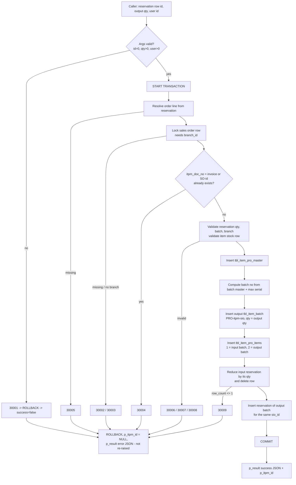

# Production workflow reference

Verified on **2026-10-30** against the configured database `u611891957_deva` (MariaDB 11.8.9), using read-only
`SHOW CREATE PROCEDURE`, `information_schema` and `SELECT` queries. No data was written during inspection.

Legend: ✅ verified from the live definition / data · 🔎 inferred from DDL defaults, not executed · ❓ unresolved.

> **Headline finding.** `sp_save_production_entry` is **not** a BOM-driven "produce this order line" procedure. It takes a
> **single reservation row** (`itbsr_id`) and an output quantity, converts *that reservation* into a new finished batch, and
> re-reserves the output for the same sales-order line. It does **not** read the BOM, does **not** change physical stock,
> and allows **only one production entry per sales order**. See [§9](#9-limitations-and-conflicts-with-the-requested-design).

---

## 1. Stored procedure

Created `2026-10-29 17:13:17`, `MODIFIES SQL DATA`, `SQL SECURITY INVOKER`, definer `u611891957_deva`.
Stored `sql_mode` = `NO_AUTO_CREATE_USER,NO_ENGINE_SUBSTITUTION` (non-strict) ✅.

| # | Mode | Name | Type | Purpose ✅ |
|---|------|------|------|-----------|
| 1 | IN  | `p_itbsr_id`   | `INT(11)`        | Row id in `tbl_item_batchstock_reserve` — the **input** reservation to consume. Its `sio_id` identifies the sales-order line/order; its `itbh_id` is the input (raw-material) batch; its `itbsr_qty` is the quantity consumed. |
| 2 | IN  | `p_output_qty` | `DECIMAL(10,6)`  | Quantity of finished item to create (max `9999.999999`). Stored as-is — **no UOM conversion**. |
| 3 | IN  | `p_user_id`    | `INT(11)`        | Production user; written to `itpm_createdby` and `itbh_createduser`. |
| 4 | OUT | `p_itpm_id`    | `INT(11)`        | New `tbl_item_pro_master.itpm_id`, or `NULL` on failure. |
| 5 | OUT | `p_result`     | `LONGTEXT`       | JSON document (see §7). No `RETURN` value; it is a procedure. |

The procedure has no `p_smo_id`, `p_branch_id`, item, warehouse, batch or BOM parameter — all are **derived** from `p_itbsr_id`.

## 2. Tables read / written

| Table | Operation | Why |
|---|---|---|
| `tbl_item_batchstock_reserve` | SELECT (`FOR UPDATE`), **UPDATE**, **DELETE**, **INSERT** | Read input reservation; reduce it by its full quantity; delete it when it reaches 0; insert the output reservation. |
| `tbl_sales_items_order` | SELECT | Line → `smo_id`, `sio_id`, `itbs_id`, `itm_id`, `tum_id`, `sio_length`, `sio_width`. |
| `tbl_sales_master_order` | SELECT `FOR UPDATE` | Order lock; `smo_invoice_no`, `branch_id`. |
| `tbl_item_batch` | SELECT, **INSERT** | Read input batch (`itbh_cost`, `branch_id`); create output batch. |
| `tbl_itembranch_stock` | SELECT (existence only) | Output item must exist in the order's branch. |
| `tbl_item_batch_master_items`, `tbl_item_batch_master` | SELECT | Batch prefix / suffix / serial rule for the output item. |
| `tbl_item_pro_master` | SELECT, **INSERT** | Duplicate-document check; header row. |
| `tbl_item_pro_items` | **INSERT** ×2 | One input row, one output row. |

**Not touched** ✅: `tbl_item_master_bom`, `tbl_item_master`, `tbl_item_uom`, `tbl_stock_transactions`,
`tbl_itembranch_stock.itbs_stock`, `tbl_item_batch.itbh_currentqty` of the **input** batch, `tbl_item_batch_master.itbm_serl`.

## 3. Table structures

### `tbl_item_pro_master` (production header) — 0 rows at inspection
| Column | Type | Null | Default | Written by SP as |
|---|---|---|---|---|
| `itpm_id` PK | int(11) auto_increment | NO | | → `p_itpm_id` |
| `itpm_doc_no` | varchar(50) | NO | `'0'` | `COALESCE(NULLIF(smo_invoice_no,''), CONCAT('SO-', smo_id))` |
| `itpm_docdate` | datetime | YES | NULL | `CURRENT_TIMESTAMP` |
| `itpm_createdby` | int(11) | NO | 0 | `p_user_id` |
| `itpm_createddate` | datetime | YES | NULL | `CURRENT_TIMESTAMP` |

There is **no** column for sales order, item, quantity, status or branch on the header.

### `tbl_item_pro_items` (production lines) — 0 rows at inspection
| Column | Type | Null | Default | Meaning |
|---|---|---|---|---|
| `itpi_id` PK | int(11) auto_increment | NO | | |
| `itpi_branch` | int(11) | NO | 0 | Sales-order branch |
| `itpm_id` | int(11) | YES | NULL | → `tbl_item_pro_master.itpm_id` |
| `itpi_serial` | int(11) | NO | 0 | SP writes `1` (input) and `2` (output) |
| `itbh_id` | int(11) | NO | 0 | → `tbl_item_batch.itbh_id` (input batch or output batch) |
| `itpi_inputoutput` | int(11) | NO | 0 | `1` = input / consumed, `2` = output / produced |
| `itpi_quantity` | decimal(10,6) | NO | 0 | Input: reservation qty (input batch units). Output: `p_output_qty` |
| `itpi_cost` | decimal(10,6) | NO | 0 | Input: batch cost. Output: `reservation_qty × batch_cost ÷ p_output_qty` |

### `tbl_item_batchstock_reserve` (reservations) — 3 rows at inspection
`itbsr_id` PK, `branch_id` int NOT NULL (no default), `itbh_id` int, **`itbsr_qty` decimal(10,3)**, `sio_id` int,
`itbrs_date` datetime (default `0000-00-00 00:00:00`), `itbrs_by` int (default 0), `itbrs_priority` int (default 0).
No status column. The SP's insert supplies only `sio_id, itbh_id, itbsr_qty` 🔎 → with the non-strict stored `sql_mode`,
`branch_id`, `itbrs_date`, `itbrs_by` take implicit defaults (`0`, zero-date, `0`). Existing rows show `branch_id = 0` ✅
(the app's own `InsertReservation` also omits `branch_id`).

### `tbl_item_batch` columns the SP sets on the output batch
`itbh_custbatchid = 'PRO-<itpm_id>-<sio_id>'`, `itbm_prefix/suffix/serl`, `itbh_no = prefix + serial + suffix`, `branch_id`
(order branch), `itbs_id`, `itm_id`, `tum_id` (**line** `tum_id`), `itbh_no_piece`/`itbh_startqty`/`itbh_currentqty` =
`p_output_qty`, `itbh_length`/`itbh_width` (line), `itbh_status = 1`, `itbh_created_doc_type = 2`,
`itbh_cost` (unit), `itbh_costotal = reservation_qty × batch_cost`, `itbh_created_doc_id = itpm_id`,
`itbh_createddate`, `itbh_createduser`.
⚠️ `itbh_created_doc_type = 2` is **also** used by the purchase flow (all 24 existing batches have type 2). Production batches
are distinguishable only by the `PRO-` prefix of `itbh_custbatchid`.

## 4. Relationships (no foreign keys are declared ✅ — only primary keys)

```
tbl_sales_master_order.smo_id ──< tbl_sales_items_order.smo_id
tbl_sales_items_order.sio_id  ──< tbl_item_batchstock_reserve.sio_id
tbl_item_batchstock_reserve.itbh_id >── tbl_item_batch.itbh_id
tbl_item_pro_master.itpm_id   ──< tbl_item_pro_items.itpm_id
tbl_item_pro_items.itbh_id    >── tbl_item_batch.itbh_id          (input and output batches)
tbl_item_batch.itbh_created_doc_id = tbl_item_pro_master.itpm_id   (production batches only)
tbl_item_batch.itbh_custbatchid   = 'PRO-<itpm_id>-<sio_id>'       (the only link back to the order line)
```
Link from a production entry to a sales order line therefore exists **only** through the output batch's
`itbh_custbatchid`, and from the header to an order only through `itpm_doc_no` (= invoice no. or `SO-<smo_id>`).

## 5. Execution sequence ✅

1. Validate `p_itbsr_id > 0`, `p_output_qty > 0`, `p_user_id > 0` → else error **30001**.
2. `START TRANSACTION`.
3. Resolve `smo_id` from reservation → line. Missing → **30005**.
4. Lock `tbl_sales_master_order` row; missing → **30002**; `branch_id` NULL → **30003**.
5. `v_doc_no = invoice_no or 'SO-<smo_id>'`. If any `tbl_item_pro_master.itpm_doc_no = v_doc_no` exists → **30004**.
6. Lock and read reservation + line + input batch (`LEFT JOIN`). Reservation qty ≤ 0, no batch, or batch branch ≠ order branch (when batch branch is not NULL) → **30006**.
7. Line lacks `itbs_id`/`itm_id` → **30007**. No `tbl_itembranch_stock` row for (itbs_id, itm_id, order branch) → **30008**.
8. `output_cost = reservation_qty × COALESCE(batch_cost,0) ÷ p_output_qty`.
9. Insert `tbl_item_pro_master`; `p_itpm_id = LAST_INSERT_ID()`.
10. Compute batch number (§6) and insert the output `tbl_item_batch` row.
11. Insert `tbl_item_pro_items` serial 1 (input, reservation qty) and serial 2 (output, `p_output_qty`).
12. `UPDATE` reservation `itbsr_qty = itbsr_qty − reservation_qty` (guarded by `itbsr_qty >= reservation_qty`); `ROW_COUNT() <> 1` → **30009**.
13. `DELETE` the reservation row when its quantity is 0 (always, since the full quantity was consumed).
14. Insert a new reservation: `(sio_id, output batch, p_output_qty)`.
15. `COMMIT`; set `p_result` success JSON.

## 6. Stock, batch and BOM behaviour

* **Stock deduction — none.** The input batch's `itbh_currentqty`, `tbl_itembranch_stock.itbs_stock` and
  `tbl_stock_transactions` are untouched ✅. Raw material is **released from the reservation** but is not physically
  consumed by this procedure. ❓ Whether another workflow deducts it is unknown (§10).
* **Finished-batch creation.** One new batch (`itbh_currentqty = p_output_qty`) is created and immediately reserved for the
  same `sio_id`. `tbl_itembranch_stock.itbs_stock` is **not** increased and no ledger row is written ✅.
* **Batch numbering.** Prefix/suffix/serial come from the latest `tbl_item_batch_master_items` row for the output item;
  serial = `max(itbm_serl)` over batches with the same prefix/suffix + 1, or `master.itbm_serl + 1` if larger. The master
  serial is neither locked nor updated (concurrent calls for different orders could generate the same number ❓).
* **BOM.** Not read. `tbl_item_master_bom` (columns `itm_id_output, itm_id_input, itmbi_serialno, itmbi_type, tum_id, itmbi_qty`;
  2,419 rows, all `itmbi_type = 1`, `tum_id = 1`) is never consulted. The procedure does not verify that the reserved input
  batch belongs to a BOM component of the line item, nor that `p_output_qty` matches the BOM ratio.
* **Multiple components.** Exactly **one** input row is written (`'input_count': 1`). A BOM with several components cannot be
  fully recorded by one call.
* **UOM.** No conversion. `p_output_qty` is stored directly as output batch quantity and `tum_id` is the **order line's**
  `tum_id`; input quantity is the reservation quantity in the input batch's own units (batches hold purchase-UOM
  quantity per the existing stock model). The caller must pre-convert. 🔎 `itbsr_qty` is `decimal(10,3)` while
  `p_output_qty` is `decimal(10,6)`, so the output reservation is rounded to 3 decimals while the output batch keeps 6.
* **Multi-order isolation.** The SP consumes exactly the reservation row it is given, so another order's reservation can only be consumed if its row id is passed. It verifies the row belongs to a valid order, but **not** that it belongs to the order the caller is working on — the caller must check.

## 7. Transaction and error handling ✅

* Transaction begins after parameter validation and is `COMMIT`ted inside the procedure.
* `DECLARE EXIT HANDLER FOR SQLEXCEPTION` → `ROLLBACK`, `p_itpm_id = NULL`, and `p_result` is
  `{"success":false,"error_code":<errno>,"sql_state":"<state>","message":"...","itpm_id":null}`. The procedure **does not re-raise**,
  so the client sees a normal completion and must inspect `p_result`.
* Custom errors (`SQLSTATE 45000`): 30001 invalid args · 30002 order missing · 30003 order has no branch · 30004 production
  already exists for this order number · 30005 reservation/order missing · 30006 invalid reservation qty/batch/branch ·
  30007 line lacks item stock id · 30008 no branch stock row · 30009 reservation could not be reduced.
* Because the procedure commits internally, a caller-supplied outer transaction would be committed implicitly; **do not wrap the call in one**.
* Success JSON: `success, error_code (0), message, itpm_id, smo_id, itbsr_id, output_qty, output_itbh_id, output_itbsr_id, doc_no, input_count`.
* Duplicate calls: replaying the same `p_itbsr_id` fails (30005 — row deleted); any second call for the same order fails (30004).

## 8. Example invocation

Illustrative values only (not executed): consume reservation row `101` and create `10` units for user `7`.

```sql
CALL sp_save_production_entry(101, 10.000000, 7, @itpm_id, @result);
SELECT @itpm_id, @result;
-- @result: {"success": true, "error_code": 0, "message": "Production entry created successfully",
--           "itpm_id": 1, "smo_id": 3, "itbsr_id": 101, "output_qty": 10.000000,
--           "output_itbh_id": 25, "output_itbsr_id": 7, "doc_no": "SO-3", "input_count": 1}
```

C# request payload (see `web\App_Code\ProductionModels.cs`):

```json
{ "reservationId": 101, "outputQty": 10.000000, "userId": 7 }
```

## 9. Limitations and conflicts with the requested design

| Requested behaviour | What the procedure actually does |
|---|---|
| Load BOM components and pass them | Procedure takes no BOM/components; it reads none. |
| Multiple production entries per sales order | **Only one**: `itpm_doc_no` is derived from the order and must be unique (30004). |
| Consume raw materials on production entry | Only the **reservation** is consumed; physical stock is not reduced. |
| Add finished stock | New batch created and reserved; branch stock / ledger not updated. |
| Multi-component BOM | One input reservation per call (and only one call per order). |
| UOM conversion | None in the procedure — caller responsibility. |
| Status / planned qty / dates | Not stored. Only the header created date and the batch exist. |

The pre-existing app code (`SalesOrderStock.MoveToProduction`, Reserved Items tab) **does** all of these things in C# and writes its
own `itpm_doc_no` (`<invoice>/L<sio_id>[/n]`), so it never collides with the procedure's `SO-<id>` numbers. It inserts directly into
`tbl_item_pro_master` / `tbl_item_pro_items`, consumes raw material batches, adjusts `itbs_stock`, and writes `tbl_stock_transactions`
(`action_type = 12`). The two paths are therefore **not equivalent**.

## 10. Unresolved schema / business-rule questions ❓

0. **Defect (blocking).** Every valid call currently fails with MySQL error **1267** — `Illegal mix of collations (utf8mb4_general_ci,IMPLICIT) and (utf8mb4_unicode_ci,IMPLICIT) for operation '='`. See [§11](#11-live-test-results-2026-10-30).
1. Should raw materials be physically deducted (`itbh_currentqty`, `itbs_stock`, ledger) for SP-created production? The SP releases the reservation but leaves stock unchanged, making the raw material look **free again**. Which workflow, if any, deducts it?
2. Is one production entry per sales order intentional? It blocks partial production and multi-line orders.
3. How should a multi-component BOM be produced with a single-input procedure?
4. Should the output batch increase `tbl_itembranch_stock.itbs_stock` and write a ledger row?
5. The SP does not verify that the reserved batch is a BOM component of the line's item, or that quantity ratios match the BOM.
6. `itbh_created_doc_type = 2` is shared with purchases — what is the intended code for production?
7. Output reservation drops `branch_id`, `itbrs_date`, `itbrs_by` (implicit defaults) — intentional? The Production tab must tolerate `0000-00-00` dates.
8. Batch-number generation is not serialised across orders (master serial neither locked nor advanced).
9. Output UOM: output batch `tum_id` is the line `tum_id`, but batch quantity elsewhere is in the **purchase** UOM (see `inventory_database_relationships.md`). Which should `p_output_qty` use when sales and purchase UOMs differ?
10. No production status / quantity-per-order is persisted, so "pending" and "produced" must be derived from batches/reservations.

## 11. Live test results (2026-10-30)

Run through the real `ProductionService` / `SalesOrderStock` code against the configured database with temporary fixtures
(a stock batch for BOM component 3344 and reservations for order 2 / line 2). Every run recorded the created ids and removed them;
row counts, reservation sums, batch quantity sums, `itbs_stock` sums and ledger rows were identical before and after
(only auto-increment counters advanced).

| Test | Result |
|---|---|
| SP argument validation (`user = 0`) | 30001, rolled back ✅ |
| SP with a non-existent reservation id | 30005, rolled back ✅ |
| Service pre-checks: qty 0, qty > 9999.999999, reservation of another order, reservation that is not a BOM component | Rejected before the database is called ✅ |
| **Valid call** (reservation 5 units of BOM component 3344, output 5, user 7) | ❌ **error 1267**, rolled back, no rows created |
| Production-only (250 MTR pending, nothing reserved / 100 reserved / 250 reserved / 300 reserved) | Blocked with "Reserve …"; entry allowed for 100 and 250; 300 blocked as over-reservation ✅ |
| Partial finished stock (100 free of 250) | Blocked until the 100 are reserved, then pending = 150; entry allowed for 150 raw, blocked for 250 raw ✅ |
| Full finished stock reserved | "No production is required" ✅ |
| Stale quantity / unknown reservation / closed order status | Refused with refresh messages ✅ |
| Read side (overview, history, details) on rows shaped exactly as the SP writes them (inserted by SQL, **not** by the SP) | Required 150, produced 150, pending 0, status Produced, finished reserved 250 (100 stock + 150 produced), 2 `tbl_item_pro_items` rows, raw-material row, no ledger ✅ |

**Cause of the defect (most likely).** `tbl_item_pro_master.itpm_doc_no` is `utf8mb4_general_ci`, while the procedure's local variable
`v_doc_no VARCHAR(50)` takes the database default `utf8mb4_unicode_ci`; `WHERE itpm_doc_no = v_doc_no` therefore mixes two implicit
collations. The batch-prefix lookup in the same procedure already uses `CONVERT(... ) COLLATE utf8mb4_general_ci`. A likely fix is
`WHERE itpm_doc_no = v_doc_no COLLATE utf8mb4_general_ci` (not applied — the procedure was deliberately left unchanged). Other statements may
surface further collation errors once this one is fixed; a valid end-to-end call has therefore **not** been demonstrated.
Output-reservation defaults (`branch_id = 0`, zero `itbrs_date`, `itbrs_by = 0`) were confirmed by inserting a row with the procedure's column list.

## 12. Application integration

| Piece | File |
|---|---|
| Models (`ProductionEntryRequest/Result`, `ProductionMaster`, `ProductionItemRecord`, `ProductionInputReservation`, `ProductionPayloadContext`) | `web\App_Code\ProductionModels.cs` |
| Only caller of `sp_save_production_entry` (parameters, OUT handling, validation, error mapping, in-process duplicate guard) | `web\App_Code\ProductionService.cs` |
| Overview, history, details, entry options, save orchestration | `web\App_Code\SalesOrderProduction.cs` (partial `SalesOrderStock`) |
| Web methods `LoadProduction`, `LoadProductionEntry`, `SaveProduction`, `LoadProductionJob` | `web\web_sales\view_sales_order.aspx.cs` |
| Production Details tab, entry modal, details modal | `web\web_sales\view_sales_order.aspx` |

Rules enforced before the call (the procedure itself does not): order is in an open status; finished stock is reserved first (a partial
shortfall is produced only after the available finished quantity is reserved); the BOM has exactly one component; the chosen reservation belongs to
**this** order line, is a BOM component, is in the order's warehouse, and would not produce more than the pending quantity; the output has at most
3 decimals (reservation column precision); no entry exists yet for the order; total produced for the line would not exceed the ordered quantity.
The pending quantity is the ordered quantity less what is already invoiced, so invoicing finished stock does not re-open production.
After the procedure succeeds, `SalesOrderStock.ApplyProductionStock` applies the movements the procedure omits, in one transaction:
the raw-material batch and `itbs_stock` are reduced, the finished `itbs_stock` is increased, and `tbl_stock_transactions` rows
(`action_type = 12`) are written. If that step fails the entry stays saved and the user sees a warning. The existing Reserved Items
"Move to production" button (`SalesOrderStock.MoveToProduction`) applies the same total-produced cap.
Both production buttons are labelled **Produce** and share the same checks and messages (open status, BOM, finished stock first, total-produced cap).
The Production tab's stored-procedure route adds its own limits (one raw material, one production per order, one reservation chosen by the user) and says so.
Each production job has an **Undo** action (`SalesOrderStock.UndoProduction`, web method `UndoProduction`): it retires the finished batch
(quantity 0, `itbh_status = 0`), removes its reservation, returns the raw material to its batches and re-reserves it for the line, reverses
`itbs_stock` and writes reversing ledger rows (only when the job had ledger rows), then deletes the `tbl_item_pro_master` / `tbl_item_pro_items`
rows. It is refused once finished stock has been invoiced or used, or is reserved by another order, and only while the order is Approved or Processed.

## 13. Workflow diagram


